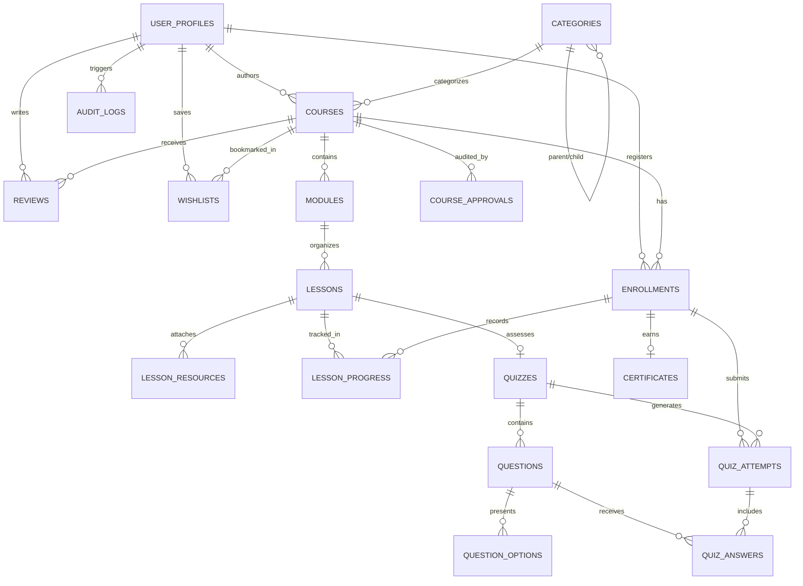

# Entity-Relationship Diagram (ERD)

## Entity Details & Attributes

- **`user_profiles`**: `id` (PK, UUID), `email`, `full_name`, `avatar_url`, `role` (STUDENT, INSTRUCTOR, ADMIN), `account_status` (ACTIVE, SUSPENDED), `bio`, `created_at`, `updated_at`.
- **`courses`**: `id` (PK, UUID), `title`, `slug`, `subtitle`, `description`, `category_id` (FK), `instructor_id` (FK), `price`, `level` (BEGINNER, INTERMEDIATE, ADVANCED, ALL_LEVELS), `status` (DRAFT, SUBMITTED, APPROVED, REJECTED, ARCHIVED), `thumbnail_url`, `created_at`, `updated_at`.
- **`modules`**: `id` (PK, UUID), `course_id` (FK), `title`, `description`, `order_index`, `created_at`.
- **`lessons`**: `id` (PK, UUID), `module_id` (FK), `title`, `content_type` (VIDEO, ARTICLE, QUIZ), `video_url`, `content_text`, `duration_minutes`, `order_index`, `is_free_preview`.
- **`enrollments`**: `id` (PK, UUID), `user_id` (FK), `course_id` (FK), `progress_percentage`, `status` (ACTIVE, COMPLETED, DROPPED), `enrolled_at`, `completed_at`.
- **`lesson_progress`**: `id` (PK, UUID), `enrollment_id` (FK), `lesson_id` (FK), `is_completed`, `completed_at`, `last_watched_second`.
- **`certificates`**: `id` (PK, UUID), `enrollment_id` (FK, UNIQUE), `certificate_code` (UNIQUE), `issued_at`, `pdf_url`.
- **`quizzes`**: `id` (PK, UUID), `lesson_id` (FK, UNIQUE), `title`, `passing_percentage`, `created_at`.
- **`questions`**: `id` (PK, UUID), `quiz_id` (FK), `question_text`, `question_type` (MULTIPLE_CHOICE, TRUE_FALSE), `points`, `order_index`.
- **`question_options`**: `id` (PK, UUID), `question_id` (FK), `option_text`, `is_correct`, `order_index`.
